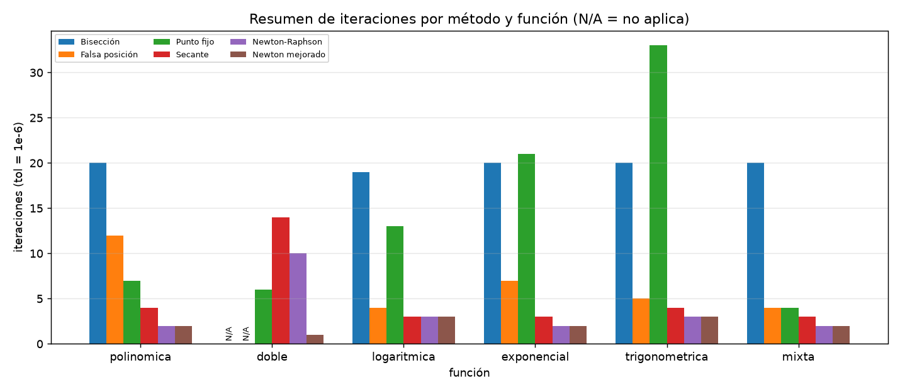
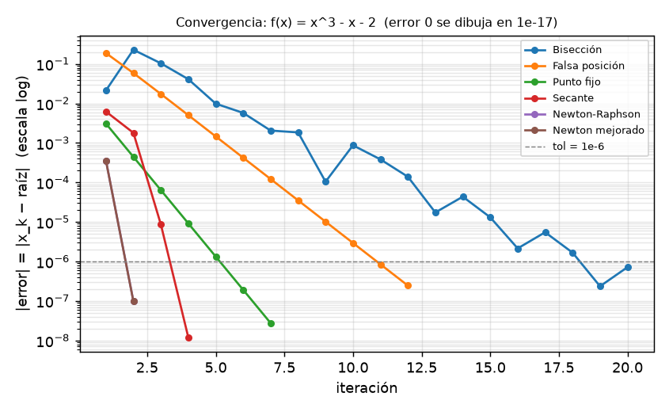
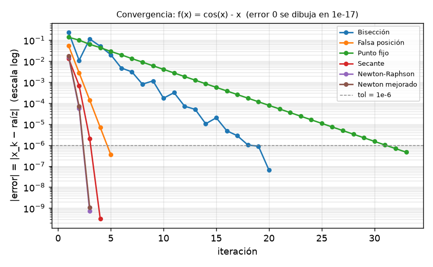
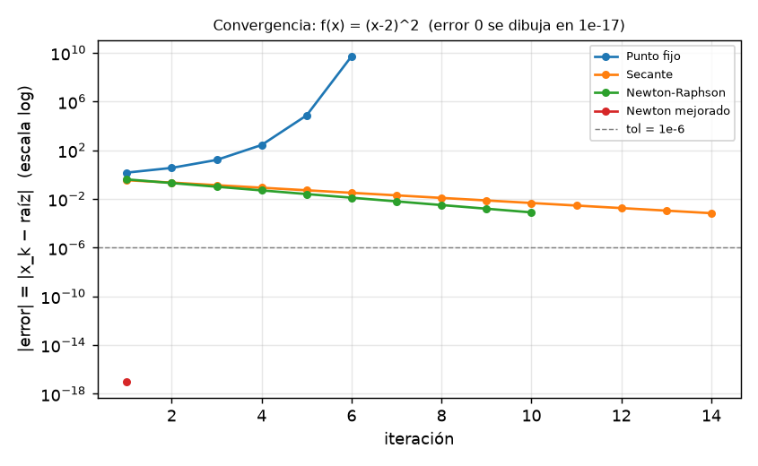

# Informe — La raíz que se esconde

Evaluación 2 — Laboratorio de Computación Numérica, UCM
Integrantes: Elías González, Daniel Navarrete

Todos los números y gráficos de este informe salen de los scripts de `src/scripts/` (ver `README.md`). Los datos están en `src/data/` y los gráficos en `src/assets/`.

## 1. Objetivo

Implementar y comparar seis métodos numéricos para aproximar raíces, registrar las iteraciones y errores con tolerancia `1e-6` y máximo de 100 iteraciones, y analizar su convergencia mediante CSV y gráficos.

## 2. Ambiente controlado

**Parámetros comunes:** tolerancia `1e-6`, tope de `100` iteraciones y criterio de parada
`|f(xₙ)| < tol` **o** `|xₙ − xₙ₋₁| < tol`. El error que se reporta es el **error real**
`|xₙ − raíz|`, usando una raíz de referencia calculada con 200 pasos de bisección (o la raíz
exacta, en la raíz doble).

**Los seis métodos:** bisección, falsa posición, punto fijo, secante, Newton-Raphson y
Newton mejorado. Este último es el Newton para raíces múltiples:
`xₙ₊₁ = xₙ − f·f′ / (f′² − f·f″)`, que equivale a aplicar Newton a `u(x) = f(x)/f′(x)`,
función que tiene una raíz *simple* aunque `f` tenga una doble.

## 3. Resultados de convergencia

Iteraciones necesarias con tol = 1e-6 (`src/data/resumen_convergencia.csv`). `N/A` = el método no aplica; `Div.` = diverge.

| Función | Bisección | Falsa posición | Punto fijo | Secante | Newton | Newton mejorado |
|---|---|---|---|---|---|---|
| Polinómica | 20 | 12 | 7 | 4 | **2** | **2** |
| Doble | N/A | N/A | Div. | 14 | 10 | **1** |
| Logarítmica | 19 | 4 | 13 | **3** | **3** | **3** |
| Exponencial | 20 | 7 | 21 | 3 | **2** | **2** |
| Trigonométrica | 20 | 5 | 33 | 4 | **3** | **3** |
| Mixta | 20 | 4 | 4 | 3 | **2** | **2** |

Resumen gráfico: `src/assets/resumen_iteraciones.png`.

Orden de convergencia estimado (`src/data/orden_convergencia.csv`, calculado con tol = 1e-15 para tener más puntos):

| Función | Bisección | Falsa posición | Punto fijo | Secante | Newton | Newton mejorado |
|---|---|---|---|---|---|---|
| Polinómica | 1,00 | 1,00 | 1,00 | 1,81 | 2,01 | 2,06 |
| Doble | – | – | – | 1,00 | 1,00 | – |
| Logarítmica | 1,00 | 1,00 | 1,00 | 1,68 | – | – |
| Exponencial | 1,00 | 1,00 | 1,00 | 1,99 | 2,00 | 2,00 |
| Trigonométrica | 1,00 | 1,00 | 1,00 | 1,75 | 2,00 | 2,00 |
| Mixta | 1,00 | 1,00 | 1,00 | 1,89 | 2,00 | 2,00 |

Los guiones significan que no se pudo estimar: o el método no aplica, o convergió en tan pocas iteraciones que no quedaron puntos suficientes para calcular la pendiente (por ejemplo, Newton en la logarítmica, o Newton mejorado en la raíz doble, que llega a la raíz en un solo paso).

## 4. Respuestas a las preguntas de convergencia

### 4.1 ¿Qué método convergió en menos iteraciones en cada función? ¿Por qué?

- **Polinómica, exponencial y mixta:** Newton y Newton mejorado (2 iteraciones).
- **Trigonométrica:** Newton y Newton mejorado (3).
- **Logarítmica:** empate en 3 entre secante, Newton y Newton mejorado.
- **Raíz doble:** Newton mejorado (1 iteración).

Newton gana porque usa la derivada, que le da información de la pendiente real de la función en cada punto, y su convergencia es cuadrática: cuando ya está cerca de la raíz, el número de dígitos correctos se duplica en cada paso. La secante aproxima esa derivada con dos puntos y queda apenas por detrás (3–4 iteraciones) sin necesitar f′. Bisección es la más lenta (19–20 iteraciones) porque solo usa el signo de f y reduce el intervalo a la mitad cada vez, es decir, necesita ≈ log₂((b−a)/tol) pasos sin importar la forma de la función.

Dos observaciones sobre los datos:

- Falsa posición fue muy buena en las funciones casi lineales en el intervalo (4 iteraciones en la logarítmica y en la mixta), pero necesitó 12 en la polinómica, donde la curvatura es mayor.
- Punto fijo depende de la función `g` elegida: tomó 4 iteraciones en la mixta pero 33 en la trigonométrica, porque la rapidez depende de cuánto vale |g′(raíz)| (más cercano a 1 es más lento).

### 4.2 ¿Qué orden de convergencia tiene cada método y cómo se refleja en el gráfico |error| vs iteración?

| Método | Orden medido | Teórico |
|---|---|---|
| Bisección, falsa posición, punto fijo | 1,00 | Lineal |
| Secante | 1,68 – 1,99 | ≈ 1,618 (superlineal) |
| Newton y Newton mejorado (raíz simple) | 2,00 – 2,06 | 2 (cuadrático) |

El orden medido de la secante cae entre 1,68 y 1,99, algo por encima de 1,618 porque la estimación se hace con muy pocos puntos (3–4 pasos) y es ruidosa; aun así, está claramente entre el orden lineal y el cuadrático.

En los gráficos `src/assets/convergencia_<clave>.png` (|error| en escala log) esto se ve así:

- **Métodos lineales:** el error cae como una recta de pendiente constante (bisección reduce el error aproximadamente a la mitad por iteración; punto fijo, por un factor cercano a |g′|).
- **Newton y Newton mejorado:** la curva se vuelve cada vez más vertical, porque el exponente del error se duplica en cada paso. Por eso llegan a 1e-12 o menos en 3 iteraciones.
- **Secante:** una curva intermedia, más empinada que las rectas lineales pero menos que Newton.

### 4.3 ¿Qué métodos requieren un intervalo con cambio de signo y cuáles no?

- **Requieren cambio de signo:** bisección y falsa posición (métodos cerrados). Si f(a)·f(b) > 0 lanzan error. En la función de raíz doble, `(x−2)² ≥ 0`, no existe tal intervalo y ambos aparecen como **no aplica** en el resumen.
- **No lo requieren:** punto fijo, secante, Newton y Newton mejorado (métodos abiertos). Solo necesitan estimaciones iniciales, pero a cambio no tienen garantía de convergencia (ver 4.5).

### 4.4 Función que toca el eje x (raíz doble): ¿qué métodos fallan o no aplican y cuál se comporta mejor?

Resultados para f(x) = (x − 2)² con x₀ = 1,2:

| Método | Resultado |
|---|---|
| Bisección y falsa posición | No aplican (sin cambio de signo) |
| Punto fijo, g(x) = x − (x−2)² | **Diverge** (el valor sale a ≈ −5·10⁹) |
| Secante | 14 iteraciones, error final 6,7·10⁻⁴ |
| Newton-Raphson | 10 iteraciones, error final 7,8·10⁻⁴ |
| Newton mejorado | **1 iteración**, error 0 |

Por qué:

- **Punto fijo** diverge porque para x < 2 se cumple |g′(x)| = |1 − 2(x−2)| > 1, así que la iteración se aleja de la raíz.
- **Newton y secante** sí llegan, pero con convergencia **lineal** (p ≈ 1,00 medido), no cuadrática: en una raíz doble f′(raíz) = 0 y Newton solo reduce el error a la mitad en cada paso (partiendo de 0,8, después de 10 iteraciones queda 0,8/2¹⁰ ≈ 7,8·10⁻⁴, que coincide con lo medido).
- **Newton mejorado** se comporta mejor porque aplica Newton a f/f′, que para esta función es (x−2)/2, una función con raíz **simple** y lineal. Por eso encuentra la raíz exacta en un solo paso, y también lo hizo en 1 iteración desde x₀ = 0, 3,5 y 10 (ver `sensibilidad.csv`).

**Cuidado con el criterio de parada:** en la raíz doble, |f(x)| < 1e-6 equivale a |x − 2| < 1e-3. Por eso Newton y secante se detienen con "convergió" aunque el error real es del orden de 10⁻⁴: el criterio basado en |f| es engañoso cuando f′(raíz) = 0.

### 4.5 ¿Cómo influyen el intervalo inicial y la estimación inicial en las iteraciones y en la convergencia?

Datos de `src/data/sensibilidad.csv`.

**Métodos cerrados (cambiar el intervalo):**

| Función | Método | Intervalo base | Intervalo más ancho | Intervalo muy ancho |
|---|---|---|---|---|
| Polinómica | Bisección | 20 ([1,2]) | 22 ([0,3]) | 24 ([−5,5]) |
| Polinómica | Falsa posición | 12 | 30 | 75 |
| Exponencial | Bisección | 20 ([0,1]) | 21 ([−1,2]) | 23 ([−10,10]) |
| Exponencial | Falsa posición | 7 | 14 | **no converge** ([−10,10]) |
| Logarítmica | Falsa posición | 4 ([2,3]) | 8 ([1,10]) | 11 ([0,5;100]) |

- **Bisección** crece muy poco al ensanchar el intervalo (+4 iteraciones al pasar de [1,2] a [−5,5]): el costo crece solo con log₂ de la longitud, y siempre converge.
- **Falsa posición** es mucho más sensible: de 12 a 75 iteraciones en la polinómica, y en la exponencial con [−10,10] no alcanzó la tolerancia en 100 iteraciones. Con intervalos amplios y una función muy curva, uno de los extremos queda "pegado" y el otro avanza lentamente.

**Métodos abiertos (cambiar x₀):**

| Función | Método | Mejor x₀ | Peor caso |
|---|---|---|---|
| Polinómica | Newton | 2 iter (x₀=1,5) | 37 iter (x₀=0,5, cerca de f′=0) |
| Polinómica | Newton mejorado | 2 (x₀=1,5) | 28 (x₀=0,5) |
| Trigonométrica | Newton | 3 (x₀=0,5) | **no converge** (x₀=−3 y x₀=10) |
| Trigonométrica | Newton mejorado | 3 | 21 (x₀=10) |
| Logarítmica | Newton mejorado | 3 (x₀=2,5) | **no converge** (x₀=0,5: salta a x<0, fuera del dominio de ln) |
| Mixta | Newton | 2 (x₀=0,5) | **no converge** (x₀=10) |
| Mixta | Newton mejorado | 2 | **no converge** (x₀=0,05 y x₀=10) |
| Mixta | Secante | 3 | **no converge** (x₀=10) |
| Exponencial | Secante | 3 | 7 (x₀=−2) |

- Newton es el más rápido con un buen x₀ (2–3 iteraciones) pero también el más frágil: si x₀ está cerca de un punto con f′ ≈ 0 (polinómica en x₀=0,5; trigonométrica en x₀=−3) el paso es enorme y la iteración salta lejos (en la trigonométrica con x₀=−3 oscila y no converge en 100 iteraciones), y si x₀ está lejos puede divergir (mixta con x₀=10).
- Newton mejorado ayudó en algunos casos (trigonométrica x₀=−3: converge en 9 mientras Newton no; polinómica x₀=−3: 8 vs 30 iteraciones), pero falló donde Newton sí funcionaba (logarítmica x₀=0,5 y mixta x₀=0,05), porque en esos puntos la segunda derivada es grande y el paso lo saca del dominio de ln(x) o √x.
- Punto fijo (con las `g` elegidas) convergió en todos los x₀ probados de las funciones con raíz simple, sin importar el punto de partida (entre 4 y 34 iteraciones), porque en esas `g` se cumple |g′| < 1 cerca de la raíz y la iteración es contractiva. Es más lento, pero más estable.

### 4.6 ¿Qué método recomiendan según el tipo de función?

| Situación | Método recomendado | Justificación con nuestros datos |
|---|---|---|
| Función suave con raíz simple y buena estimación inicial | Newton-Raphson | 2–3 iteraciones, orden 2,00 |
| No se conoce f′ o es costosa | Secante | 3–4 iteraciones, orden ≈ 1,7–2,0, sin derivada |
| Se necesita garantía de convergencia (robustez) | Bisección | Siempre convergió en 19–24 iteraciones, incluso con [−10,10] |
| Función casi lineal en el intervalo con cambio de signo | Falsa posición | 4–5 iteraciones en logarítmica, mixta y trigonométrica (pero se degrada con intervalos anchos) |
| Raíz doble (toca el eje) | Newton mejorado | 1 iteración vs 10 de Newton; los cerrados no aplican |
| Plantear una iteración sencilla con `g` contractiva | Punto fijo | Convergió siempre en raíz simple, pero es lineal (4–33 iteraciones) |

La opción más sensata en la práctica es combinar: usar bisección para acotar la raíz y luego Newton o secante para refinar.

## 5. Conclusión final

**¿Qué método elegir para cada tipo de función y por qué (velocidad vs robustez)?**
 En nuestras seis funciones, Newton y Newton mejorado fueron los más rápidos (2–3 iteraciones, orden cuadrático ≈ 2,00) y la secante quedó muy cerca (3–4 iteraciones, orden entre 1,68 y 1,99) sin necesitar la derivada. Bisección fue la más lenta (19–20 iteraciones, orden lineal) pero fue la única que nunca falló en ningún intervalo de la prueba de sensibilidad (hasta [−10, 10]). Es decir, los métodos abiertos ganan en velocidad y los cerrados en seguridad, y la elección depende de si se conoce un buen punto de partida o un intervalo con cambio de signo.

**¿Qué ocurrió en la raíz doble y qué dice sobre "tener raíz" frente a "cambiar de signo"?**
La función (x−2)² tiene raíz en x = 2, pero nunca cambia de signo, y por eso bisección y falsa posición no aplican: el teorema de Bolzano da una condición suficiente para asegurar una raíz, no necesaria. Además, los métodos abiertos clásicos se degradan: Newton y secante pasan de convergencia cuadrática/superlineal a lineal (p ≈ 1,00), punto fijo diverge, y el criterio |f(x)| < tol engaña, pues se cumple con un error real cercano a 10⁻³. Solo Newton mejorado, que trata a la función como si tuviera raíz simple al usar f/f′, la resuelve en 1 iteración.

**¿Cómo cambió el número de iteraciones al mover el intervalo o la estimación inicial?**
Ensanchar el intervalo casi no afectó a bisección (20 → 24 iteraciones en la polinómica), pero sí a falsa posición (12 → 75), que además dejó de converger en la exponencial con [−10, 10]. En los métodos abiertos el efecto fue mayor: Newton pasó de 2 a 37 iteraciones al mover x₀ de 1,5 a 0,5 en la polinómica, y dejó de converger en la trigonométrica (x₀ = −3 y x₀ = 10) y en la mixta (x₀ = 10). La rapidez de Newton solo está garantizada cerca de la raíz; lejos de ella, depende fuertemente del punto de partida.

En conclusión los números muestran, que no existe un método mejor en todos los casos; el más rápido (Newton) es el menos seguro, el más seguro (bisección) es el más lento, y la raíz doble es el caso donde la teoría clásica falla y hay que usar un método adaptado.